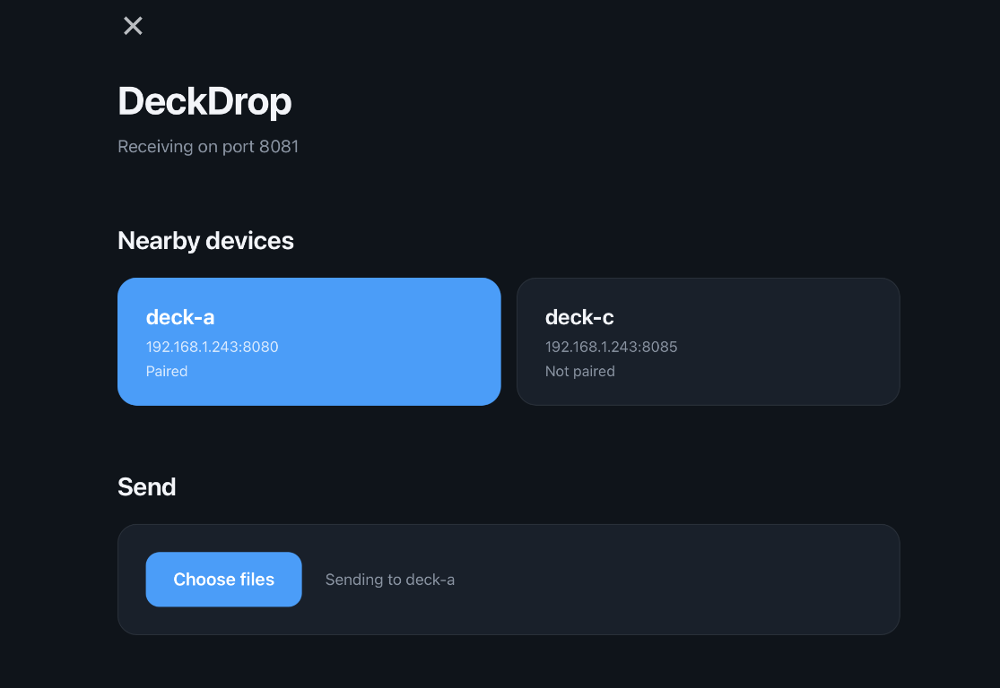
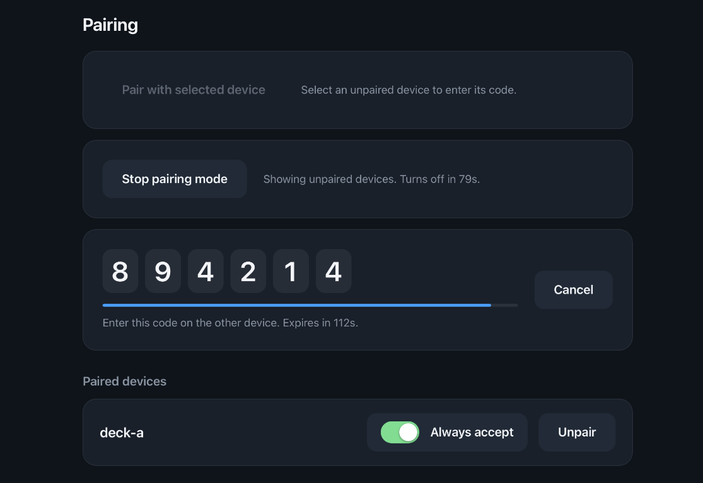

# DeckDrop

Send files between your Steam Deck, PC and Mac over your home network. No accounts, no cloud: devices find each other on the local network, and everything is encrypted.

- **For users:** [Install](#install), [Send your first file](#send-your-first-file), [Good to know](#good-to-know)
- **For advanced users:** [Headless mode and configuration](#advanced-headless-mode-and-configuration)
- **For developers:** [Development](#development), [HTTP API](#http-api), [Security design](#security-design)

---

# For users

## Install

Download the latest build for your system from the [Releases page](https://github.com/TobyPinfold/deck-drop/releases):

| System                | Download                       |
| --------------------- | ------------------------------ |
| Steam Deck / Linux    | AppImage                       |
| Windows               | Installer                      |
| macOS (Apple Silicon) | Zipped app                     |

The macOS and Windows builds are not signed yet. On macOS, right-click the app and choose **Open** the first time. On Windows, SmartScreen may warn you; choose **More info**, then **Run anyway**.

## Send your first file

Install DeckDrop on both devices, and make sure they are on the same network. DeckDrop works with a gamepad as well as a mouse: use the D-pad to move, A to select and B to go back.



**1. Pair the devices (once).** Only paired devices can send files to each other.

1. On the device that will *receive*, choose **Pair a device**, then **Show a code**.
2. On the device that will *send*, choose **Pair a device**, then **Enter a code**. Pick the receiver and enter the six digit code.



**2. Send.** Select the receiver in **Nearby devices**, then choose **Send files** (or drop files on the window).

**3. Accept.** The receiver asks whether to **Accept** or **Decline** (B declines). Accepted files are saved to `Downloads/DeckDrop` in your home folder, and appear under **Received**.

Pairing works one way: pairing B with A lets B send to A. To send both ways, pair the other way round too.

## Good to know

- **Pausing and resuming:** pause a transfer, or lose the connection, and resume continues where it stopped. You are not asked to accept again.
- **Skip the prompt:** turn on **Always accept** next to a paired device you trust.
- **Unpairing:** **Unpair** removes a device, and it can no longer send until it is paired again.
- **Who can see you:** only paired devices are listed. Unpaired devices appear for two minutes while pairing mode is on. To stop announcing your device altogether, turn on **Hide this device** in Settings. Paired devices that know its address can still send.
- **Settings:** the device name, receive folder and port can be changed in **Settings**. Changes apply straight away. If the new port is in use, your previous settings stay.
- **Pairing codes:** a code works once, expires after two minutes, and is discarded after five wrong guesses. Check that it is shown on the device you expect.
- **Limits:** hiding a device and pairing reduce who can see and send to you, but they do not stop someone on your network who is sniffing traffic from seeing that DeckDrop is in use. File contents stay encrypted.
- **Starting over:** deleting DeckDrop's config folder gives the device a new identity, and devices paired with the old one will refuse it. Pair again.

Your settings, pairings and identity are kept in your user config folder: `~/Library/Application Support/DeckDrop` on macOS, `~/.config/DeckDrop` on Linux, `%AppData%\DeckDrop` on Windows.

---

# For advanced users

## Advanced: headless mode and configuration

The same binary runs without a window, for example on an always-on box that just receives files. Add `--headless`:

```sh
deckdrop --headless --pair                 # log a one-time pairing code at startup
deckdrop --headless --accept               # accept files from paired devices without asking
deckdrop --headless --port 9000 --name nas
```

A headless device has nobody to ask, so it **declines every offer unless you run it with `--accept`**, which accepts anything from paired devices.

Environment variables and flags override saved settings for that run; flags win over environment variables.

| Flag         | Environment variable   | Default                                   | Description                                              |
| ------------ | ---------------------- | ----------------------------------------- | -------------------------------------------------------- |
| `--port`     | `DECKDROP_PORT`        | `8080`                                    | TCP port to listen on (1-65535)                          |
| `--dir`      | `DECKDROP_RECEIVE_DIR` | `~/Downloads/DeckDrop` (`received_files` headless) | Directory received files are saved to   |
| `--name`     | `DECKDROP_DEVICE_NAME` | machine hostname                          | Device name shown to other devices                       |
| `--headless` |                        | off                                       | Run without the desktop window                           |
| `--pair`     |                        | off                                       | Log a one-time pairing code at startup (headless)        |
| `--accept`   |                        | off                                       | Accept files from paired devices without asking (headless) |

```sh
DECKDROP_RECEIVE_DIR=$HOME/Downloads/DeckDrop deckdrop --headless
```

Run `deckdrop --help` to list the options.

Try sending between two instances on one machine by running one headless and one with the window, with different ports and names:

```sh
deckdrop --headless --port 8099 --name other-deck --dir /tmp/dd-test --pair --accept
deckdrop    # pair with "other-deck" using the logged code, then send it a file
```

The headless backend announces itself on the local network as `_deckdrop._tcp` via mDNS and saves received files to `./received_files` by default. Stop it with Ctrl+C.

---

# For developers

## Development

Requirements:

- Go 1.27 or newer (see `go.mod`)
- Node.js (current LTS) for the frontend
- The Wails CLI: `go install github.com/wailsapp/wails/v3/cmd/wails3@v3.0.0` (make sure `$(go env GOPATH)/bin` is on your `PATH`)
- On Linux / Steam Deck: GTK 4 and WebKitGTK 6.0 (for example `libgtk-4-dev libwebkitgtk-6.0-dev`)
- [golangci-lint](https://golangci-lint.run/) for `make lint` (optional)

Run `wails3 doctor` to check your setup.

```sh
wails3 dev                            # run the desktop app with live reload
make app                              # build the app into bin/
go build -o deckdrop ./cmd/deckdrop   # build the headless-only binary
make test                             # run the Go tests
make lint                             # run the linter
cd frontend && npm test               # frontend tests
```

After changing methods or types exposed to the frontend, regenerate the bindings with `wails3 generate bindings -clean=true -ts -i` and commit the result.

### Code layout

DeckDrop is a single binary: a [Wails v3](https://v3.wails.io) window that embeds the backend, which starts and stops with the window. The frontend is Preact with htm, built with Vite, in `frontend/`.

The root package wires the Wails desktop application; `cmd/deckdrop` is the headless entry point. `internal/app` is the desktop-facing facade. `internal/backend` owns the receiving server lifecycle, with HTTP routes in `internal/backend/httpapi` and command-line/environment parsing in `internal/backend/config`. Identity, trust, pairing, offers, discovery, sending, settings and received-file history live in their own `internal` packages.

### Releases

Pushing a tag such as `v0.1.0` runs the Release workflow, which builds a Linux AppImage, a Windows installer and a macOS app bundle (zipped, Apple Silicon) and attaches them to a GitHub release. The workflow also runs on pull requests that change `build/` so packaging problems are caught early.

## HTTP API

Files are sent in chunks so interrupted transfers can resume. The server speaks HTTPS only (TLS 1.3); see [Security design](#security-design).

| Endpoint                   | Description                                                                                                                 |
| -------------------------- | --------------------------------------------------------------------------------------------------------------------------- |
| `GET /health`              | Returns 200 when the backend is running                                                                                     |
| `POST /pair`               | Pairs a device that proves it knows the one-time code                                                                       |
| `POST /offer`              | Asks the receiver to accept a list of files (`{"files":[{"name","size"}]}`). Waits for the user: 204 accepted, 403 declined |
| `POST /upload`             | Writes the request body at a byte offset. Headers: `X-File-Name`, `X-File-Offset`. Returns 204                              |
| `GET /status?filename=...` | Returns the bytes received so far in the `X-File-Offset` header, to resume from                                             |

`/offer`, `/upload` and `/status` return 403 unless the caller presented the certificate of a paired device. `/upload` and `/status` also return 428 for a file that was not offered and accepted, and an upload cannot go past the size that was offered. Uploads over the maximum chunk size (64 MiB) are rejected with 413. Invalid file names are rejected with 400.

Only `/health` and `/pair` can be called without pairing, for example `curl -k https://localhost:8080/health` (`-k` because the certificate is self-signed).

## Security design

### Identity and encryption

Each device creates a self-signed certificate the first time it runs (`identity.crt` and `identity.key` in the config folder; the key is readable only by you). Its SHA-256 fingerprint identifies the device and is advertised in the mDNS `fp=` record. All transfers are encrypted with TLS 1.3.

### Pairing

The receiver shows a one-time six digit code. The code is never sent: the other device sends an HMAC of both certificate fingerprints keyed with the code, so someone watching the network, or sitting in the middle with their own certificate, cannot reuse it. The code expires after two minutes, works once, and is discarded after five wrong attempts.

Each side stores the other's certificate fingerprint in `paired.json` in the config folder, and the sender pins it. The server requests a client certificate and accepts requests only from paired fingerprints, so the certificate is the credential and there are no tokens.

### Offers

A paired device must offer its files first. The receiver's user accepts or declines, and an unanswered offer is declined after a minute. Nothing is written until an offer is accepted, and only the offered files, up to their offered sizes, are accepted. Grants are held in memory, are removed when a file completes, and expire after a day unused, so resuming does not ask again.

### Visibility

By default only paired devices are listed. Pairing mode lists nearby unpaired devices for two minutes. The **Hide this device** setting stops mDNS announcing entirely.

### Trust model and limits

- There is no certificate authority. A sender checks that a device's certificate matches the fingerprint it has pinned for it.
- Connections to a paired device are authenticated: the sender refuses a certificate that is not the pinned one. The fingerprint advertised over mDNS is only a hint for finding the pin; anyone can announce anything, but cannot present the paired device's certificate.
- Pairing is only as strong as the code: an attacker has five guesses at a one in a million code per pairing attempt, and the person pairing should check the code appears on the device they expect.
- mDNS is multicast on the local network. Hiding reduces what is listed and who can send, but does not hide a device from someone sniffing the network.
- Deleting the identity files gives the device a new identity, which devices that pinned the old one will reject.
