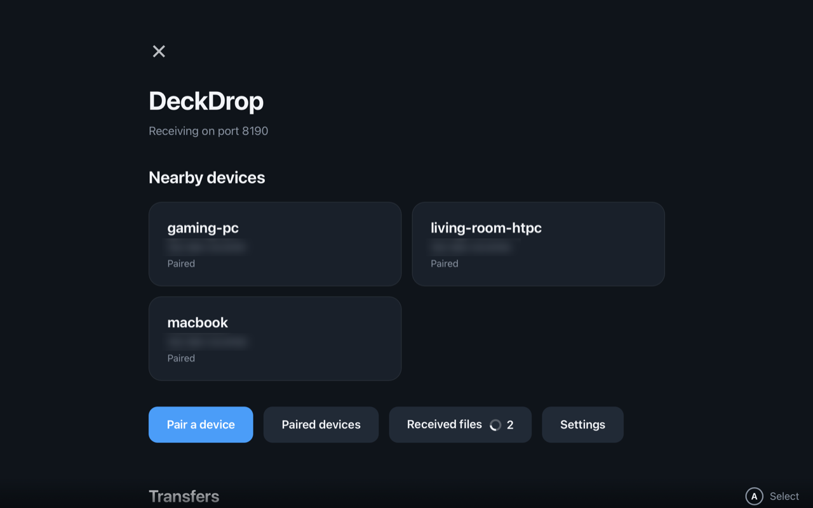
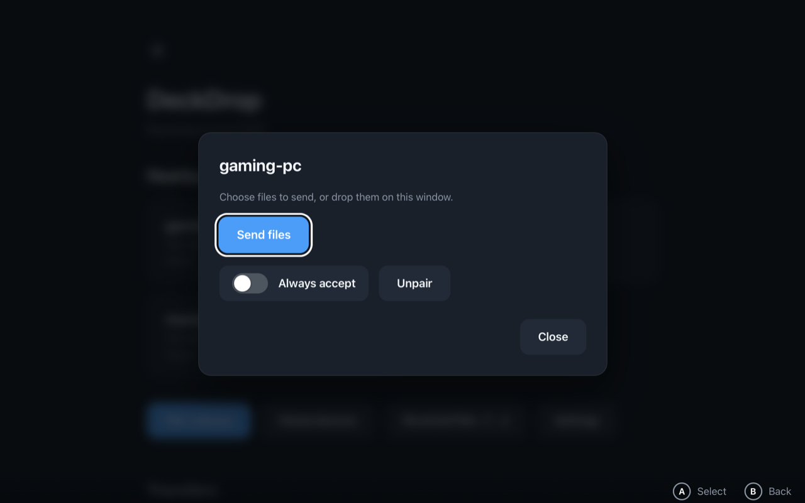
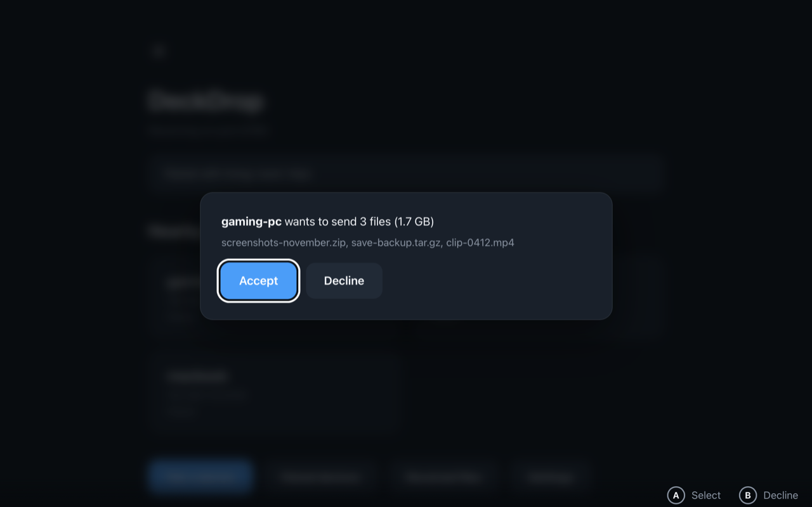
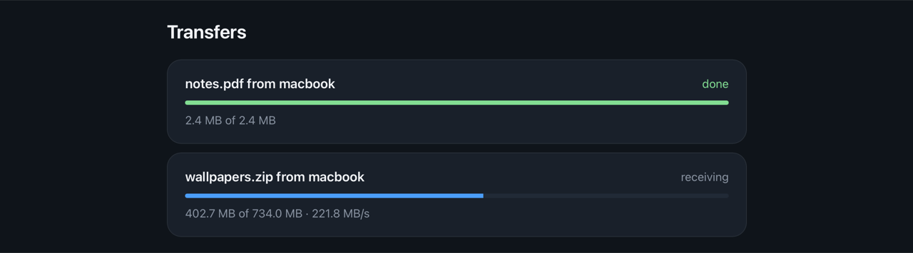
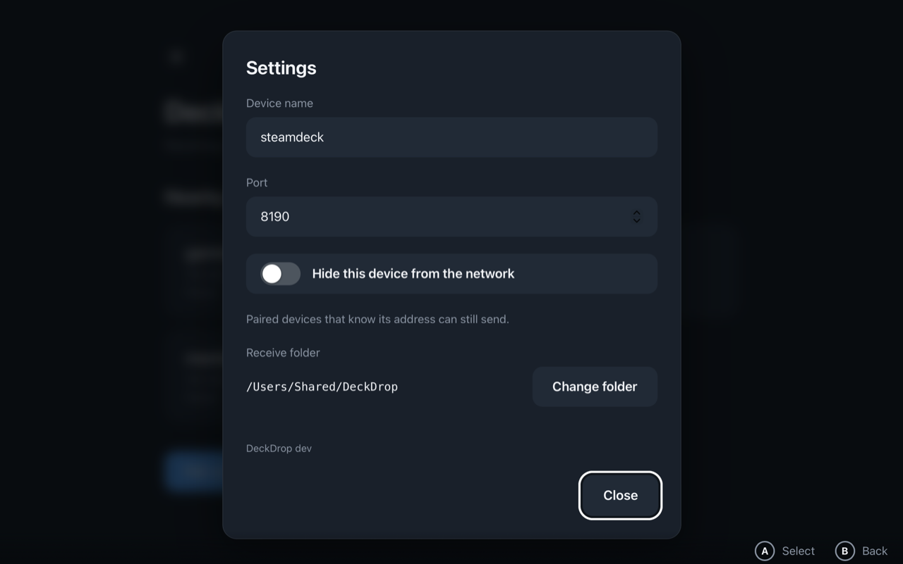

# DeckDrop

**Send files between your Steam Deck, PC and Mac over your home network.**
No accounts, no cloud, no cables. Devices find each other automatically, and every transfer is encrypted.

## Features

- **Built for the Steam Deck.** Works in Game Mode with the gamepad: D-pad to move, A to select, B to go back. A mouse and keyboard work too.
- **Finds devices on its own.** Nearby devices show up automatically over your local network. There are no IP addresses to type.
- **Private by design.** Files go straight from one device to the other over TLS 1.3. Nothing passes through a server.
- **You decide what arrives.** Devices pair once with a six digit code, and you accept or decline every incoming transfer, unless you mark a device as trusted.
- **Resumes big transfers.** Pause a transfer, or lose the connection, and it picks up where it stopped.
- **Runs anywhere.** Steam Deck and Linux (x86_64 and arm64), Windows, and macOS. There is also a [headless mode](docs/headless.md) for always-on machines.

## Install

Download the latest build from the [Releases page](https://github.com/TobyPinfold/deck-drop/releases):

| System                      | Download                       |
| --------------------------- | ------------------------------ |
| Steam Deck / Linux (x86_64) | `deckdrop-x86_64.AppImage`     |
| Linux (arm64)               | `deckdrop-aarch64.AppImage`    |
| Windows                     | `deckdrop-amd64-installer.exe` |
| macOS (Apple Silicon)       | `deckdrop-macos.zip`           |

**Steam Deck / Linux:** right-click the AppImage, open **Properties → Permissions** and allow it to run as a program. To open DeckDrop from Game Mode, see [Adding DeckDrop to Steam](docs/steam.md).

### First launch on macOS and Windows

The macOS and Windows builds aren't signed yet, because signing them needs paid certificates. Your system warns you about unsigned apps the first time you open them. You only need to do this once.

**macOS**

1. Unzip `deckdrop-macos.zip` and move **deckdrop** into your **Applications** folder.
2. Open it. macOS says it could not verify the app. Choose **Done**.
3. Open **System Settings → Privacy & Security** and scroll down to **Security**. Next to the message about deckdrop, click **Open Anyway**, then confirm with your password or Touch ID.

After that it opens normally. On macOS 14 and earlier, you can instead right-click the app and choose **Open**.

**Windows**

1. Run `deckdrop-amd64-installer.exe`.
2. If **Windows protected your PC** appears, choose **More info**, then **Run anyway**.

## How it works

Install DeckDrop on both devices and make sure they are on the same network.

### 1. Pair (once)

On the device that will **receive**, choose **Pair a device → Show a code**. On the device that will **send**, choose **Pair a device → Enter a code**, pick the receiver and type the code.

Pairing works one way: it lets the sender send to the receiver. To send both ways, pair the other way round too.

### 2. Send

Select a paired device under **Nearby devices** and choose **Send files**, or drop files on the window.

### 3. Accept

The receiver is asked to **Accept** or **Decline**. Accepted files are saved to `Downloads/DeckDrop` in your home folder and listed under **Received files**.

Progress shows under **Transfers** on both devices. Transfers can be paused and resumed, and an interrupted one carries on where it stopped.

## Good to know

- **Skip the prompt:** turn on **Always accept** for a paired device you trust. **Unpair** removes a device, and it can no longer send until it is paired again.
- **Who can see you:** only paired devices are listed. Unpaired devices appear for two minutes while you are pairing. To stop announcing your device altogether, turn on **Hide this device** in **Settings**. Paired devices that already know its address can still send.
- **Settings:** the device name, receive folder and port can be changed in **Settings**, and apply straight away.
- **Pairing codes** work once, expire after two minutes, and are discarded after five wrong guesses. Check the code is shown on the device you expect.
- **Where your data lives:** settings, pairings and the device's identity are kept in `~/Library/Application Support/DeckDrop` on macOS, `~/.config/DeckDrop` on Linux, and `%AppData%\DeckDrop` on Windows. Deleting this folder gives the device a new identity, so you will need to pair again.

## More documentation

- [Headless mode and configuration](docs/headless.md): run DeckDrop without a window, plus every flag and environment variable.
- [Security design](docs/security.md): how pairing, encryption and trust work, their limits, and the HTTP API.
- [Development](docs/development.md): building from source, running tests, code layout and releases.
- [Contributing](CONTRIBUTING.md): commit conventions and what to run before opening a pull request.

## License

DeckDrop is released under the [GNU General Public License v3.0](LICENSE).
